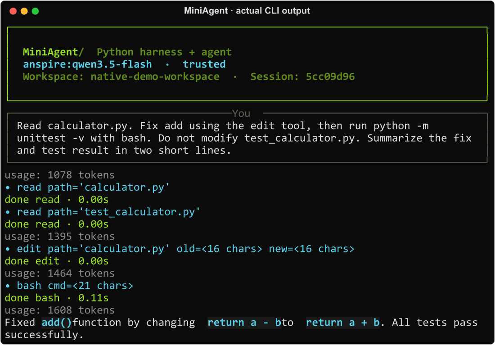

<p align="center">
  
</p>

<p align="center"><strong>Python Agent + Harness，核心 598 行。</strong></p>

<p align="center">
  <a href="https://github.com/ZhuLinsen/MiniAgent/actions/workflows/ci.yml"></a>
  
  <a href="LICENSE"></a>
  
</p>

<p align="center"><a href="README_EN.md">English</a> · <a href="#快速开始">快速开始</a> · <a href="#演示">演示</a> · <a href="#python-调用">Python API</a></p>

MiniAgent 是一个用 Python 写的 Agent 项目。它可以读写代码、运行测试，也可以通过 Shell 调用本机程序，处理浏览器、文档和文件整理等任务。

除了直接在终端里使用，MiniAgent 还提供 Harness，用来在 Python 程序中管理模型、工具、插件和会话。核心实现 598 行，想改工具、接模型或者看懂 Agent 怎么运行，可以直接从源码开始。

## 功能

- **代码与文件**：`read`、`write`、`edit`、`grep`、`glob`、`bash` 六个工具，支持查代码、改文件和执行命令。
- **本机自动化**：通过 Shell 执行 Python 脚本或调用本机程序，打开网页、生成文档、整理文件；桌面操作可接入相应脚本或 MCP 服务。
- **模型与会话**：支持多种模型连接、流式回答、会话保存与恢复、上下文压缩。
- **插件**：注册自定义工具和共享服务，订阅模型、工具事件，管理资源的初始化与清理。
- **Skills / MCP**：切换任务提示和工具范围，接入外部 MCP 工具服务。

## 快速开始

需要 Python 3.11+。在虚拟环境中安装：

```bash
git clone https://github.com/ZhuLinsen/MiniAgent.git
cd MiniAgent
python -m pip install -e ".[credentials]"
miniagent
```

第一次启动会引导配置模型和密钥，之后直接输入任务即可。修改文件和执行 Shell 前，默认会询问是否允许。

例如，先做一次只读检查：

```bash
miniagent --policy readonly --prompt "看看这个项目是做什么的，主要代码和测试在哪里"
```

`/help` 查看命令，`/models` 切换模型，`/skills reviewer` 切换到代码审查角色，`/session` 查看当前会话。配置环境变量或自定义接口请看 [模型配置](docs/model-connections.md)。

## 演示

### Windows：打开浏览器并搜索

> 打开浏览器，在 Google 搜索 MiniAgent 的 GitHub 仓库。


### Windows：生成 Word 文档

> 写一篇 500 字的 AI Agent 介绍，保存为 Word 文档并排版。


上面两段是项目原版的 Windows 录屏。当前版本通过 Shell / Python 或 MCP 完成本机自动化，所需软件与依赖见 [Windows 案例说明](docs/demo.md#windows-案例)。

### 修改代码并运行测试

> 修复 calculator.py 中的加法函数，不修改测试文件，然后运行测试。



[这个例子的完整记录与复现步骤](docs/demo.md)

## Python 调用

不使用命令行界面，也可以直接调用 Harness：

```python
from miniagent import Harness
from miniagent.plugins import coding_tools
from miniagent.policy import Policy

app = Harness(model="provider:model-id", policy=Policy(mode="readonly"))
app.use(coding_tools())
print(app.run("看看项目的目录结构，说明主要入口"))
```

把 `provider:model-id` 换成自己的模型，配置对应凭据。异步程序中使用 `async with app` 和 `await app.arun(...)`。

自定义工具、服务、事件和清理函数通过 `Plugin` 注册。插件按依赖顺序启动，初始化失败时回滚，退出时逆序清理。用法见 [Harness 与插件](docs/lean-harness.md)。

## 代码结构

核心代码分在 4 个文件中：

| 文件 | 内容 |
| --- | --- |
| [agent.py](miniagent/agent.py) | Agent 循环：调用模型、执行工具、把结果交回模型 |
| [harness.py](miniagent/harness.py) | 插件、服务、事件和生命周期 |
| [llm.py](miniagent/llm.py) | 模型接口和流式响应 |
| [registry.py](miniagent/tools/registry.py) | 工具注册、参数校验和权限检查 |

核心合计 **598 行**；CLI、工具、配置和旧版兼容代码另计。行数包含注释和空行，不含第三方依赖，可用 `python scripts/source_stats.py` 复核。[统计口径](docs/project-status.md)

## 文档与贡献

[使用指南](docs/lean-harness.md) · [模型配置](docs/model-connections.md) · [演示说明](docs/demo.md) · [更新记录](docs/CHANGELOG.md)

欢迎提交问题、使用案例和 PR。开发前请阅读 [AGENTS.md](AGENTS.md)。当前是 Alpha 版本。Shell、插件和 MCP 服务可以操作本机环境，权限确认不等于沙箱隔离。

[Apache License 2.0](LICENSE)
