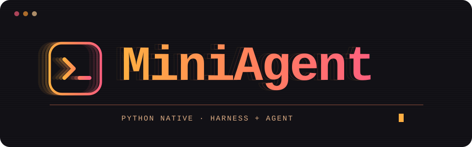
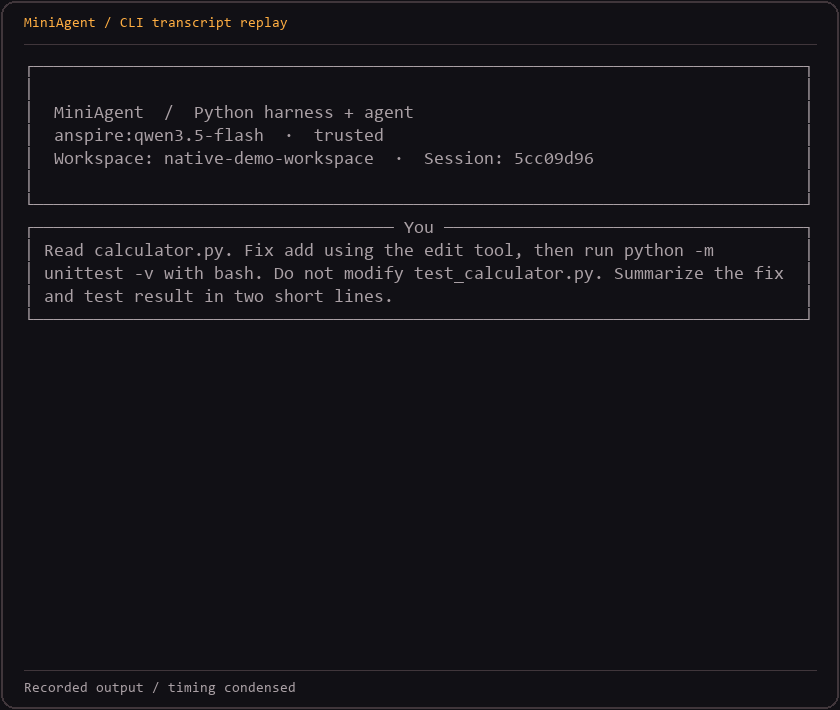

<p align="center">
  
</p>

<p align="center"><strong>🚀 Get started with Harness / Agent in five minutes and build your own command-line Manus.</strong></p>

<p align="center">
  <a href="https://github.com/ZhuLinsen/MiniAgent/actions/workflows/ci.yml"></a>
  
  <a href="LICENSE"></a>
  
</p>

<p align="center"><a href="README.md">中文</a> · <a href="#key-features">Key features</a> · <a href="#quick-start">Quick start</a> · <a href="#use-from-python">Python API</a> · <a href="#demos">Demos</a> · <a href="#project-structure">Project structure</a></p>

MiniAgent is an **ultra-lightweight Python Agent / Harness with the essentials built in**, centered on just **591 lines of core code**. It supports common agent capabilities such as tool calling, session memory, context management and plugin extensions. **Use it directly, learn how agents work, or customize it to build your own.**

## Key features

- 🧠 **Essential capabilities**: native tool calling, streaming, session memory, context compaction, Skills, MCP, plugin management and permission controls form a working Agent / Harness.
- 🚀 **Ready to use**: connect a model and run coding and automation tasks through the CLI, or embed the runtime in an existing project through the Python API.
- 📖 **Learn by exploring**: the core is just **591 lines across 4 files**, covering model calls, tool execution and plugin management. Read and run the code to understand how an Agent / Harness works.
- 🧩 **Build your own**: customize prompts and Skills, add tools and services through Plugin. Reuse the existing session and permission mechanisms as you develop your own agent.

## Quick start

Requires Python 3.11+. A virtual environment is recommended.

```bash
git clone https://github.com/ZhuLinsen/MiniAgent.git
cd MiniAgent
python -m pip install -e ".[credentials]"
miniagent
```

The first launch guides you through connecting a model. Then enter a task. File changes and Shell calls require confirmation by default.

You can also pass a task on the command line:

```bash
miniagent --policy readonly --prompt "Explain this project and find its main code and tests"
```

Use `/help` for commands, `/models` to switch models, `/skills reviewer` for code review and `/session` to inspect the session. [Model setup](docs/model-connections.md)

## Use from Python

Create an agent, attach its tools and give it a task:

```python
from miniagent import Harness
from miniagent.plugins import coding_tools
from miniagent.policy import Policy

app = Harness(model="provider:model-id", policy=Policy(mode="readonly"))
app.use(coding_tools())
print(app.run("Read the project structure and explain its entry points"))
```

Replace `provider:model-id` with your model and configure its credential. For async use, call `await app.arun(...)` inside `async with app`.

Harness manages the model/tool loop, plugin setup and cleanup, and sessions. Register your tools, shared services and event listeners through `Plugin`. [Plugins and complete examples →](docs/lean-harness.md)

## Demos

**Edit code and run tests** · Fix calculator.py while leaving the tests unchanged.



Rendered from a real CLI recording with condensed playback timing; the terminal styling comes from the presentation branch. [Still image](docs/assets/coding-session.png) · [Full recording and reproduction](docs/demo.md)

### Windows automation

<table>
<tr><th width="50%">Open a browser and search</th><th width="50%">Create a Word document</th></tr>
<tr><td align="center">Open a browser and search for the MiniAgent GitHub repository.</td><td align="center">Write an overview of AI agents, save it as a Word document and format it.</td></tr>
<tr>
<td width="50%"><a href="resource/miniagent_chrome.gif"></a></td>
<td width="50%"><a href="resource/miniagent_word.gif"></a></td>
</tr>
</table>

These recordings are from the original version; click either to enlarge. The current version uses Shell / Python or MCP for local automation. See [Windows examples and setup](docs/demo.md#windows-案例).

## Project structure

The core lives in [agent.py](miniagent/agent.py), [harness.py](miniagent/harness.py), [llm.py](miniagent/llm.py) and [tools/registry.py](miniagent/tools/registry.py). Sessions, Skills and MCP have their own modules.

```text
miniagent/
├── agent.py          # Agent loop · 65 lines
├── harness.py        # Plugins, services and lifecycle · 256 lines
├── llm.py            # Model calls and streaming · 149 lines
├── tools/
│   ├── registry.py   # Tool registration and execution checks · 54 lines
│   └── code_tools.py # File and code tools
├── plugins.py       # Built-in tools and Shell plugin
├── session.py       # Session persistence and context compaction
├── skills.py        # Skills loading and configuration
├── policy.py        # Execution permissions and file access checks
├── extensions/      # MCP integration
└── cli.py           # CLI entry point
```

The core totals **591 lines**; all first-party package Python totals **2,135 lines**. Counts include comments and blank lines and exclude third-party dependencies. Run `python scripts/source_stats.py` to verify. [Counting script](scripts/source_stats.py)

## Docs and contributing

[Guide](docs/lean-harness.md) · [Model setup](docs/model-connections.md) · [Demo notes](docs/demo.md) · [Changelog](docs/CHANGELOG.md) · [Legacy migration](docs/legacy-migration.md)

Issues, task examples and pull requests are welcome. Read [AGENTS.md](AGENTS.md) before contributing. Currently Alpha; Shell, plugins and MCP run on the host, and permission prompts do not provide sandbox isolation.

[Apache License 2.0](LICENSE)
