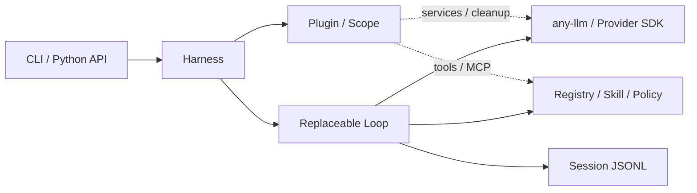

# MiniAgent 原生版状态与验收

核对日期：2026-10-17。本报告针对 `codex/native-v03` 的 **0.3.0a1 候选分支**，main 的能力以实际合入结果为准。基线为完整集成父提交 [`1be964e`](https://github.com/ZhuLinsen/MiniAgent/commit/1be964e3388161f09cb7d289ddc89d3f5007439d)，合入顺序为 **#15 展示 → #13 响应式插件 → 本原生精简 PR**。本轮不合入、不打 tag、不发版。

## 定位与边界

**Python 原生的迷你 Harness + 编程 Agent。小内核、插件组合、终端直接用。**

面向希望理解、定制和分享 Agent 的 Python 开发者。受 DSH 启发，用独立的 Python 运行时覆盖高频 CLI Coding Agent 工作流。DSH 已有启动其打包运行时的 Python SDK；本项目强调运行时自身由 Python 编写，依据 [DSH 固定版本架构](https://github.com/deepseek-ai/deepseek-harness/blob/1600d8a1e140dcde43a1a0941940a0480712c011/docs/architecture.md)。不承诺官方 SDK 兼容或完整 DSH 移植。

维护者已选择：保留 PR #7 之前的旧版分支，新版集中原生 API；本轮先完成现有能力的精简和验证，暂不新增子 Agent 与长期记忆。旧版准确保留于 [codex/legacy-pre-harness](https://github.com/ZhuLinsen/MiniAgent/tree/codex/legacy-pre-harness)，对应 PR #7 合入前第一父提交 `b437298`，包含 #6 修复。不是把旧实现移到新包的另一个目录。

## 结构

## 实际能力

| 场景 | 本候选分支 | 验证入口 / 局限 |
| --- | --- | --- |
| 模型 → 工具 → 模型循环 | 已实现 | `test_harness.py`、真实修复 Demo；不解析旧 TOOL/ARGS 文本 |
| 多 Provider / 流式工具消息 | 已实现 | `test_llm.py`、`test_provider_protocols.py`；4 类原生适配协议用本地 HTTP，网关实测单独报告 |
| Context / Service / Scope / 事件 | 已实现 | `test_harness.py`，失败回滚、逆序自动清理、实例隔离 |
| 响应式依赖等待与恢复 | 显式 opt-in | `test_reactive_plugins.py`；`reactive=True` 在启动/任务边界协调，无后台 HMR |
| 可替换 Loop | 已实现 | `loop_plugin`、自定义 Loop 与锁/取消测试；自定义 Loop 是可信代码 |
| 编程工具和统一执行边界 | 已实现 | read/write/edit/grep/glob/bash；`test_code_tools.py`、`test_tool_registry.py`、`test_runtime_recovery.py` |
| 授权、取消和不确定副作用 | 已实现 | Schema、Skill、Policy；未知副作用先核实再 resolve，不自动重放 |
| 持久会话与压缩 | 已实现 | `test_session.py`；JSONL 单写者、消息配对、完整工具组压缩 |
| Skills / MCP stdio | 已实现 | `test_mcp_skills.py` 包含真实本地子进程发现、调用、拒绝与退出；未实现 Streamable HTTP |
| 首次连接 / 模型切换 / 终端界面 | 已实现 | `test_connections.py`、`test_cli_runtime.py`、60 列帮助实际输出；其他平台外观待实测 |
| Usage / Cost | 部分 | 展示模型返回的 tokens；无统一费用计价和跨会话费用账本，不换算未经验证的金额 |
| 子 Agent / 长期记忆 / Web / HMR / 沙箱 / 插件市场 | 不在本轮交付 | 按维护者选择暂不新增；工具授权不提供容器隔离 |

这证明选定的高频 Coding Agent 工作流具备实现与验证入口，不等于“DSH 80% 的全部功能”或产品等价。DSH 对照还参考固定版本的 [Agent Loop 合约](https://github.com/deepseek-ai/deepseek-harness/blob/1600d8a1e140dcde43a1a0941940a0480712c011/packages/core/agent-loop/README.md)。

## 代码量与取舍

统计命令：`python scripts/source_stats.py`。物理行包含注释和空行；全部包包括所有官方 Python 模块，不含测试、脚本、文档或第三方依赖。

| 口径 | 集成父版本 | 原生候选 | 差额 |
| --- | ---: | ---: | ---: |
| 四文件核心 | 598 | 591 | -7 |
| 含 Policy / 工具插件 / Session 的运行机制 | 900 | 894 | -6 |
| 全部官方包 Python | 5,148 | 2,122 | -3,026 |

核心达到 500–700 行、全部包达到 2,000–2,800 行目标。减少来自明确退役的旧入口、系统工具、文本解析、反思、Memory 和编排实现；保留原生安全机制，移除全局工具目录，Shell 统一到已有异步实现。没有压行或把产品逻辑移到脚本中达标。第三方 SDK 仍是主要安装成本，源码数量不等于安装体积或性能。

## 兼容与验证证据

- 这是明确的公开 API 变化，见 [迁移说明](legacy-migration.md)。旧能力专用测试随能力退役，不能把减少的测试数称为优化；原生核心套件保留，Skill/工具案例迁至新 API，补充配置、退役入口、包内容和示例导入检查。
- 在该工作树独立创建开发环境，避免旧 checkout 的 editable 安装使已删除模块仍可被导入；独立 wheel 安装再验证新包不含旧模块。
- 当前离线验证为 **174 passed、3 live deselected**；父版本收集 295 项，候选版收集 177 项。旧能力专用测试退役，原生 Harness、响应式插件、Session、LLM、协议、MCP、连接和日志八个模块的原测试 ID 全部保留；另补原生迁移与示例检查。
- Ruff、编译、治理检查、锁文件校验、生产依赖审计与 sdist/wheel 构建通过。Windows / Python 3.12 独立 wheel 无可选依赖安装通过，wheel 为 41,210 bytes；安装环境约 34 MB，仍需第三方模型 SDK。
- 真实 API、真实 MCP 与确定性模拟分别报告。小型修复不代表复杂仓库成功率；平台凭据库、长会话、真实复杂仓库任务仍需后续验收。
- 原生提交 `3bb2f20` 的 Anspire `qwen3.5-flash` 修复与跨 CLI 会话续接通过：共 5 次请求、7,167 tokens，原测试从失败到通过且内容未改，工具结果完整配对。截图、原始文本、所有运行源文件哈希及局限见 [真实演示](demo.md)。
- 最终测试、构建、审计、安装结果见本 PR 描述与当前提交 CI；不会把父版本的绿色检查算作本候选通过。
- 原生 JSONL 格式和连接档案保留；旧 Memory JSON 不自动导入、不删除，未知工具副作用不重放。

## 传播与设计

中英文 README 同步采用短定位、快速开始、真实演示、能力表和 Python 入口。Logo 按维护者选定的暖色终端 A 方向制作可编辑 SVG；概念稿与提示词位于本地 `temp/brand-review/`。产品截图来自实际 CLI，生成 Logo 不用于伪造界面或模型结果。

推荐 GitHub About（按维护者要求保留在 PR，醒后确认，远端设置未修改）：

> A Python-native mini harness + coding agent. Small core, composable plugins, MCP, Skills & resumable sessions.

## 回滚

回滚本精简 PR 恢复完整 0.2 过渡代码；#13 和 #15 独立保留。原版用户可使用旧版分支和独立环境。保留所有 Session/Memory 文件，不因回滚重放工具。
